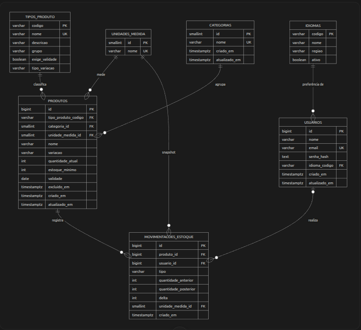

# Modelagem de dados: OdontoEstoque

## Etapa 1: Levantamento de entidades

| Entidade | Responsabilidade | Atributos principais |
| :--- | :--- | :--- |
| `idiomas` | Idiomas do app (tela Idioma) | `codigo` PK (`pt-BR`), `nome`, `regiao`, `ativo` |
| `usuarios` | Cadastro, login e perfil | `id`, `nome`, `email` (único), `senha_hash`, `idioma_codigo` FK |
| `categorias` | Categorias de produtos | `id`, `nome` (único) |
| `unidades_medida` | caixa, unidade, tubo, pacote | `id`, `nome` (único) |
| `tipos_produto` | Regras de validade e variação | `codigo` PK, `nome`, `descricao`, `grupo`, `exige_validade`, `tipo_variacao` |
| `produtos` | Itens de estoque | `id`, `tipo`/`categoria`/`unidade` FK, `nome`, `variacao`, `quantidade_atual`, `estoque_minimo`, `validade`, `excluido_em` |
| `movimentacoes_estoque` | Histórico permanente | `id`, `produto_id`, `usuario_id`, `tipo`, `quantidade_anterior`, `quantidade_posterior`, `delta` (gerado), `unidade_medida_id` |

---

## Etapa 2: DER

*(Substitua o caminho acima pela URL ou diretório onde a imagem do DER será salva no repositório).*

---

## Etapa 3: Dicionário de dados (resumo)

| Tabela.campo | Regra |
| :--- | :--- |
| `usuarios.email` | Formato validado e único sem diferenciar maiúsculas (índice em `lower(email)`). |
| `usuarios.senha_hash` | Só o hash (`bcrypt`/`argon2id`), com `CHECK` de tamanho mínimo. O mínimo de 8 caracteres e a confirmação de senha são validados na aplicação. |
| `usuarios.idioma_codigo` | FK para `idiomas`, padrão `pt-BR`. |
| `categorias.nome` | Único sem diferenciar maiúsculas. FK de `produtos` com `RESTRICT`, então não se apaga categoria em uso. |
| `unidades_medida.nome` | Singular e único. A pluralização (“12 caixas”) fica no i18n. |
| `tipos_produto.grupo` / `exige_validade` | `CHECK`: perecível se e somente se exige validade. |
| `tipos_produto.tipo_variacao` | `cor`, `tamanho` ou `NULL` (sem variação). |
| `produtos.nome` / `variacao` | Nome exibido = `nome` + `variacao` (“Resina composta A2”). Índice único parcial entre itens ativos. |
| `produtos.quantidade_atual` | Inteiro $\ge 0$. Nasce com `0` e só muda por movimentação. |
| `produtos.estoque_minimo` | Inteiro $\ge 0$. |
| `produtos.validade` | Obrigatória ou proibida conforme o tipo (trigger). |
| `produtos.excluido_em` | `NULL` significa ativo. |
| `movimentacoes_estoque.tipo` | `entrada`, `saida` ou `ajuste`. |
| `movimentacoes_estoque.quantidade_anterior` / `quantidade_posterior` | Reproduzem o “12 → 11” da tela. O trigger rejeita se a anterior não bater com o saldo atual (proteção contra concorrência). |
| `movimentacoes_estoque.delta` | Gerada: `posterior - anterior`. |
| `movimentacoes_estoque.usuario_id` | Anulável, `SET NULL` se o usuário for removido. Inserir um item novo com saldo 3 vira uma entrada `0 → 3`, como no histórico do protótipo. |